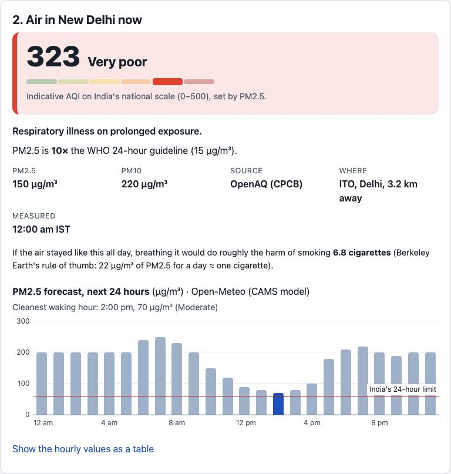
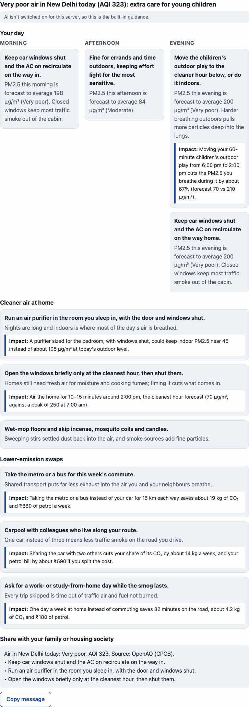
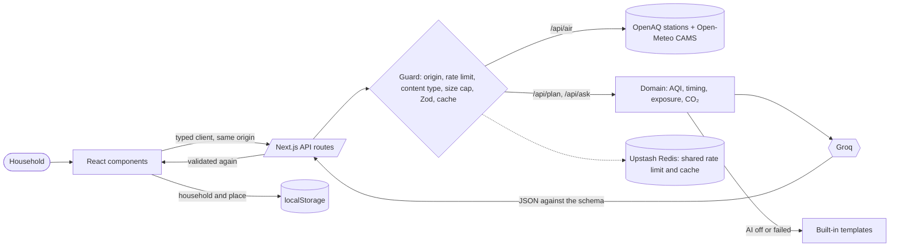

# Urban Air Quality Assistant

[](https://github.com/desilva23/air-quality-assistant/actions/workflows/ci.yml)


**Live:** https://air-quality-assistant-three.vercel.app

A GenAI assistant for Indian households living through winter smog. It reads **live** air quality for any town in India, then builds the family's day around it: when to go out, how to commute, what to do at home, and the **direct impact of each choice** in numbers the app computes rather than the AI guesses.

<p align="center">
  
  
</p>

| Any town in India | 2 AI features | 8 computed impacts | 0 axe violations | 100% coverage |
| --- | --- | --- | --- | --- |
| search or device location | language only, never the numbers | exposure, CO₂ and ₹, per household | light and dark | enforced in CI |

## Chosen vertical

**PromptWars Virtual, Challenge 6: Urban Air Quality Assistant.**

A parent in Delhi, Noida, Kolkata or Mumbai wakes to an AQI of 300+. Should the children play outside after school? Is the scooter ride to work worse than the bus? Is the purifier worth running, and should the windows open at all? Generic advice ("stay indoors") ignores who lives in the home, how they travel and when the air will actually be cleaner. This assistant answers those questions for *this* household, *today*, from live data, and shows what each choice changes.

## Approach and logic

**The data is real, the numbers are computed, and the AI only explains.** Air readings come from monitoring networks, never from the model. Every percentage and kilogram a user sees comes from tested TypeScript in `src/lib/domain`. The model writes the plan around those facts and may cite them only by id.

- **Where you are** decides the data. The nearest OpenAQ station that has reported PM2.5 in the last 3 hours (CPCB stations are among them) gives the current reading. The Copernicus CAMS model, through Open-Meteo, gives the 24-hour forecast, and stands in when no station is close or fresh. The source, station, distance and time are always shown.
- **Who lives with you** decides the caution. Children, older adults, someone with asthma, COPD or a heart condition, or a pregnant family member make the plan protect them first.
- **When you are outdoors** decides the timing. The forecast finds the cleanest waking hour and the cleanest window for your activity's length, and works out how much moving it cuts your dose.
- **How you travel** decides the swaps. Drivers and riders get the weekly CO₂ and petrol (₹) saving of metro or bus, carpooling and a work-from-home day. Open-air commuters get the mask maths for their minutes outside.
- **Your home** decides the indoor advice: purifier or not, cooking fuel, smoking.
- **Every item says why**, and items with a measurable effect carry an **Impact** line with the computed number.

## How the solution works

### Try it in two minutes (sample inputs)

1. Open the live site and press **Delhi family** under *Where are you?* This loads a household with two young children who play outside in the evening and a parent who drives 15 km to work. The air is fetched live.
2. Read **Air in New Delhi now**: the AQI on India's national scale, CPCB's health note, the source and time, and the 24-hour PM2.5 forecast with the cleanest hour highlighted.
3. Press **Build today's plan**. The evening play moves to the cleaner afternoon window with its dose cut, the commute swaps show weekly CO₂ savings, and the indoor tips fit a home without a purifier.
4. Press **Mumbai commuter** or **Kolkata seniors** and build again. The same day gives different advice: an N95 for the scooter ride, or a gentler, purifier-first plan for a couple where one has asthma.
5. Under **Ask about today**, try "Can my kids play outside this evening?"

### What it does

| Brief requirement | How it's handled |
| --- | --- |
| **GenAI-powered assistant** | Groq writes the personal plan and answers free-text questions, from the live data and the household profile (`src/lib/ai`). |
| **Families and communities** | A household profile covers children, older adults, health conditions and pregnancy. Every plan ends with a short message to copy into a family or housing-society group. |
| **Severe winter smog and urban air pollution** | Live PM2.5 and PM10 from OpenAQ stations or the CAMS model. India's AQI bands, CPCB's health notes and how many times the WHO 24-hour guideline the air is. A 24-hour forecast. |
| **Tailored to location** | Search any town in India (Open-Meteo geocoding, restricted to India) or use the device's location. Data comes from the nearest station or the model at that point. |
| **Tailored to lifestyle** | Commute mode, distance and days; main outdoor activity, its time and length; purifier, cooking fuel, smoking; usual mask. |
| **Low-emission daily routines** | A morning, afternoon and evening plan that times outdoor activity to the cleaner hours and favours metro, bus and fewer trips. |
| **Indoor air quality hacks** | Purifier placement, ventilating only at the cleanest hour, wet mopping, avoiding incense and coils, solid-fuel cooking and smoking advice. |
| **Sustainable alternatives** | Metro or bus instead of car, scooter or auto; carpooling; a work-from-home day; combining errands; no open burning. |
| **Clearly explains the direct impact of choices** | Eight computed impacts: dose cut from shifting an activity or moving it indoors, from an N95 versus the current mask, indoor PM2.5 with a purifier, the cleanest hour to air the home, and weekly CO₂ and petrol cost (₹) from switching, carpooling or staying home. |

### How GenAI is used, and where it isn't

| Feature | Model tier | What the model does |
| --- | --- | --- |
| Today's plan | Smart (`openai/gpt-oss-120b` on Groq) | Writes the morning, afternoon and evening actions, indoor tips, swaps and the share message for this household, citing computed impacts by id. |
| Ask about today | Lite (`openai/gpt-oss-20b` on Groq) | Answers a free-text question for this household from today's data, with up to three tips. |

AQI values, pollutant levels, forecasts, time windows, doses and CO₂ never come from the model. The reply must match a Zod schema whose `impactId` field is an enum of the facts computed for that request, so the model can't invent a figure. The schema is checked on the server and again in the browser. The AI runs only when the user presses **Build today's plan** or **Ask**. If no key is set, or Groq fails, the app returns a built-in plan or answer from fixed templates held to the same contract, labelled as built-in guidance.

### Architecture



```text
src/lib/domain   pure rules: Indian AQI, forecast windows, exposure, emissions, impact facts
src/lib/air      server: OpenAQ, Open-Meteo, the air report with its fallback
src/lib/ai       contracts, prompts, the Groq client, built-in fallbacks
src/lib/server   route factories, request guards, Redis or memory stores, CSP
src/lib/client   typed API client with timeouts and cancellation, saved settings, geolocation
src/components   UI only
src/app          the page, layout and one thin route file per endpoint
```

More in [docs/ARCHITECTURE.md](docs/ARCHITECTURE.md).

## Assumptions

- **India only.** Places come from a geocoder restricted to India. Device locations outside a box around India are refused. Times are shown in IST.
- **Indicative AQI.** CPCB's index uses 24-hour averages. The app applies the same bands to the latest hourly reading and says so. Above the top of CPCB's open-ended Severe band, it interpolates to 380 µg/m³ (PM2.5) and 510 µg/m³ (PM10), a common convention, and caps at 500.
- **Station freshness.** A station counts only if it reported PM2.5 within 3 hours and lies within 25 km. Otherwise the CAMS model estimate is used and labelled as such.
- **Exposure estimates** are for planning, not measurement:
  - Masks as typically worn keep out 15% (cloth), 35% (surgical) or 75% (N95, below its 95% lab rating because of fit).
  - Indoor PM2.5 is taken as 70% of outdoor with windows mostly shut, or 30% with a purifier running.
  - Door-to-door speeds are walk 5, cycle 12, scooter 22, auto 18, bus 15, metro 28 and car 22 km/h.
- **The cigarette comparison** is Berkeley Earth's rule of thumb: 22 µg/m³ of PM2.5 for a day ≈ one cigarette. The WHO comparison uses its 2021 guideline for the 24-hour mean, 15 µg/m³.
- **CO₂ factors** come from the India GHG Program's *India Specific Road Transport Emission Factors* (v1.0, 2015):
  - petrol hatchback under 1400 cc: 0.140 kg/km;
  - scooter under 110 cc: 0.0368 kg/km;
  - CNG auto-rickshaw: 0.108 kg/km;
  - intra-city bus: 0.0152 kg per passenger-km.
  
  The paper gives no metro figure, so the bus figure stands in as a conservative estimate.
- **Petrol cost** converts the CO₂ back to litres with the same paper's 2.27193 kg CO₂ per litre of petrol, at ₹95 per litre (Delhi's retail price, rounded; it differs by state and over time). Scooters and cars are taken to run on petrol, and auto-rickshaws on CNG, so autos show no petrol cost.
- **One household per browser,** with no accounts. The profile and place stay in localStorage, and are sent to the server only with a plan or question request. They are never logged.
- **General guidance, not medical advice.** The app tells people to see a doctor for breathlessness or chest pain.

## Running it

Requires Node 22.

```bash
npm ci
cp .env.example .env.local   # all keys are optional; without them the app uses the CAMS model and built-in guidance
npm run dev                  # http://localhost:3000
npm run check                # format, strict lint, Knip, typecheck, 204 tests with 100% coverage
npx playwright install chromium
npm run test:e2e             # production build in Chromium: journeys, CSP, axe in light and dark, 320 px reflow
```

### Deploying to Vercel

| Variable | Purpose |
| --- | --- |
| `GROQ_API_KEY` | AI plan and answers. Without it, the built-in guidance is used. |
| `OPENAQ_API_KEY` | Measured station readings. Without it, readings come from the CAMS model. |
| `KV_REST_API_URL`, `KV_REST_API_TOKEN` | Set by Vercel's Upstash for Redis integration. These share the rate limit and cache across instances. |

The region is `bom1` (Mumbai) in `vercel.json`. `TRUSTED_PROXY_HOPS` defaults to 1, which is right for Vercel. Details are in [docs/DEPLOYMENT.md](docs/DEPLOYMENT.md).

## Quality

### Problem statement alignment

Every phrase of the brief maps to a feature in [What it does](#what-it-does). Live data replaces generated numbers, as the challenge's expert asked. The three sample households let a reviewer see personalisation in one click.

### Code quality

- **TypeScript and lint:** strict TypeScript with `noUncheckedIndexedAccess` and five more strict flags. typescript-eslint `strictTypeChecked` and `stylisticTypeChecked` run with zero findings.
- **No escape hatches:** no type assertions in `src/` except `as const` (`consistent-type-assertions: never`), no `any`, no non-null assertions, and no disabled lint rules.
- **Limits:** functions under 80 lines, files under 250, complexity at most 10. Prettier at 100 columns, and Knip for unused code.
- **Structure:** a pure domain layer, Zod contracts shared by server and browser, and one typed client function per endpoint with typed error codes.
- **Enforcement:** a hygiene test suite checks all of this.

### Security

- **Keys and logging:** API keys are server-only, and the browser connects only to this site. User content is never logged.
- **Every API request:** same-origin check, then a rate limit shared through Redis, then content-type and streaming size checks, then Zod validation. Errors leave as codes only.
- **Pages:** a CSP with a per-request nonce and `strict-dynamic`, HSTS, `X-Frame-Options: DENY` and a strict Permissions-Policy. Zod runs without eval.
- **Prompts:** user text is fenced as data, and the model may cite only computed facts.
- **Repository:** CodeQL on every push, and [SECURITY.md](SECURITY.md).

### Efficiency

- **Shared cache:** air and place lookups are cached in Redis by rounded coordinates (10 minutes) and query (24 hours), so a busy city costs one upstream call per period. Identical AI requests are cached for 10 minutes. Hits are marked `X-Cache: HIT`.
- **Upstream calls:** the station and model sources are asked in parallel, with 6-second timeouts.
- **AI calls:** only on explicit actions, with a lite model for questions.
- **Browser:** derived values are memoised, number inputs commit on blur, and the plan and question panels load lazily.

### Testing

- **Unit and integration:** 204 Vitest tests across the domain, air data, AI, server, client, UI and hygiene suites. The gate is 100% statement, branch, function and line coverage, enforced in CI.
- **Accessibility in tests:** axe runs in the component tests.
- **Browser:** 12 Playwright tests on the production build cover the journeys, personalisation, persistence, CSP and headers, API refusals, axe in light and dark, and 320 px reflow.

Details are in [docs/TESTING.md](docs/TESTING.md).

### Accessibility

- **Structure:** landmarks and a skip link.
- **Forms:** labelled controls, with choices grouped in fieldsets.
- **Feedback:** live regions for results, and focus moves to a new plan.
- **Colour and charts:** AQI bands are always named in text. The chart has a text summary and a table view.
- **Contrast and preferences:** AA contrast in light and dark, plus `prefers-reduced-motion`, `prefers-contrast: more` and `forced-colors` support.
- **Layout:** 44 px targets, and no sideways scroll at 320 px.

Details are in [docs/ACCESSIBILITY.md](docs/ACCESSIBILITY.md).

## Evaluation criteria

| Criterion | How it is addressed | Where to look |
| --- | --- | --- |
| Code quality | strictTypeChecked with zero findings; no casts, `any` or non-null assertions; files under 250 lines; pure domain; shared Zod contracts; typed errors | `src/lib/domain`, `src/lib/client/api.ts`, `eslint.config.mjs`, `tests/quality/hygiene.test.ts`, [docs/ARCHITECTURE.md](docs/ARCHITECTURE.md) |
| Security | Server-only keys, same-origin + shared rate limit + size cap + Zod on every route, CSP nonce, prompt fencing, code-only errors, CodeQL | [SECURITY.md](SECURITY.md), `src/proxy.ts`, `src/lib/server/` |
| Efficiency | Redis cache with `X-Cache: HIT`, parallel upstream calls with timeouts, AI only on request, memoised and lazy UI | `src/lib/server/stores.ts`, `src/lib/air/report.ts`, `src/components/AssistantApp.tsx` |
| Testing | 204 unit and integration tests, 100% coverage enforced, 12 Playwright tests with axe | [docs/TESTING.md](docs/TESTING.md), `tests/`, `e2e/` |
| Accessibility | WCAG 2.2 AA target, axe in jsdom and Chromium (light and dark), reflow, preferences | [docs/ACCESSIBILITY.md](docs/ACCESSIBILITY.md), `src/app/styles/preferences.css` |
| Problem statement alignment | Live data for any town in India, personal routines, indoor tips, alternatives and computed impacts | [What it does](#what-it-does), `src/lib/domain/impacts.ts` |

## Docs

[Architecture](docs/ARCHITECTURE.md) · [Testing](docs/TESTING.md) · [Accessibility](docs/ACCESSIBILITY.md) · [Deployment](docs/DEPLOYMENT.md) · [Security](SECURITY.md) · [Contributing](CONTRIBUTING.md)

## Limitations

- **Coverage and freshness:** CPCB station coverage is uneven, and OpenAQ's copy of it can lag. Where no station is fresh, the CAMS model fills in, and on bad days it can read lower than ground stations.
- **Indoor air:** the app has no indoor sensor data, so indoor figures are estimates from the outdoor level.
- **Without Redis:** rate limits and caches are per server instance. If Redis is unreachable, requests are served rather than refused, and the failure is logged.
- **No accounts:** answers live in one browser.

## License

[MIT](LICENSE)
