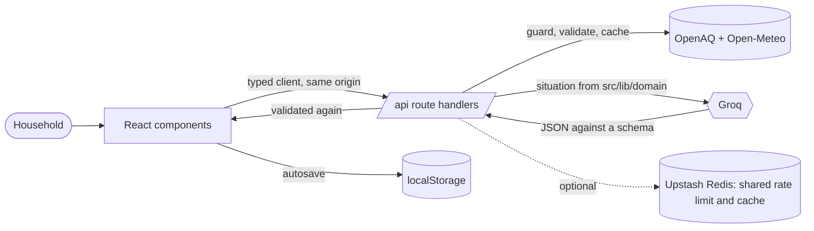

# Architecture

Urban Air Quality Assistant is a Next.js App Router app: a React page in the browser and five thin API routes on Vercel. One rule shapes everything: **air data comes from monitoring networks, every number comes from tested domain code, and the AI only explains, citing computed facts by id.**

## Layers

| Layer | Folder | Responsibility | Depends on |
| --- | --- | --- | --- |
| Domain | `src/lib/domain` | Indian AQI, forecast windows, exposure, emissions and impact facts, as pure functions with no clock, network or React | zod |
| Air data | `src/lib/air` | OpenAQ station readings, the Open-Meteo CAMS model and geocoder, and the report that picks between them | domain |
| AI | `src/lib/ai` | Contracts, prompts, the Groq client, and the built-in plan and answer | domain |
| Server | `src/lib/server` | Route factories (origin, rate limit, content type, size cap, Zod, cache, error codes), stores, CSP | ai, air |
| Client | `src/lib/client` | One typed function per endpoint with timeouts and cancellation; saved settings; device location | domain |
| UI | `src/components` | Rendering and dispatching only | domain, client |
| Routes | `src/app` | The page, the layout and one file per endpoint | server |

## Key algorithms

| Problem | Approach | Where |
| --- | --- | --- |
| India's AQI from raw concentrations | Linear interpolation inside CPCB's bands for PM2.5 and PM10; the higher sub-index wins | `src/lib/domain/aqi.ts` |
| The cleanest time to be outdoors | Slide a window of the activity's length over the next 24 hours of forecast, between 6 am and 9 pm IST, and keep the lowest mean | `src/lib/domain/timing.ts` |
| The direct impact of a choice | Dose ratios from forecast, mask protection or indoor share; CO₂ from India GHG Program factors × distance × days, and petrol cost from the same paper's CO₂ per litre | `src/lib/domain/impacts.ts`, `exposure.ts`, `emissions.ts` |
| Choosing a data source | Ask both sources at once; use the nearest station that reported within 3 h and 25 km, otherwise the model, and say why | `src/lib/air/report.ts` |
| Keeping the model honest | The reply schema's `impactId` is an enum of this request's computed fact ids | `src/lib/ai/contracts.ts` |

## Request lifecycle

1. The browser calls one typed function per endpoint (`src/lib/client/api.ts`).
2. The route factory (`ai-route.ts` or `data-route.ts`) checks the origin and the rate limit, then (for AI) the content type and the streamed size, and then validates with Zod.
3. A cache hit answers at once with `X-Cache: HIT`.
4. **Air:** OpenAQ and Open-Meteo are fetched in parallel, and the result is validated and cached for 10 minutes.
5. **Plan and questions:** the server assesses the situation, sends Groq the facts with a schema derived from the same Zod contract, then trims and validates the reply. A malformed reply is retried once.
6. If AI is off or fails, the built-in templates answer with the same contract, and the reply is labelled as built-in guidance.
7. The browser validates every reply again before showing it.

## Decisions

- **Two air sources with distinct jobs.** Stations are measured truth near the user; the model covers every point in India and gives the hourly forecast that timing needs.
- **No accounts or database.** The household and place live in localStorage. The server keeps only short-lived caches and rate-limit counters.
- **One AI provider.** Groq, with GPT-OSS models: strict structured output, and a fast lite tier for questions.
- **One deploy target.** Vercel in `bom1` (Mumbai), the region closest to the users.
